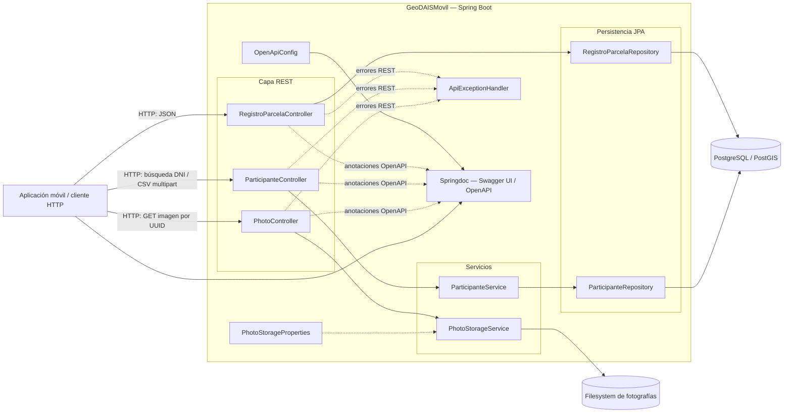

# GeoDAISMovil

Backend Spring Boot para sincronizar registros de parcela, consultar participantes y entregar fotografías; persiste los datos en PostgreSQL/PostGIS.

## Estructura del proyecto

```text
GeoDAISMovil/
├── database/                         # Scripts SQL de actualización del esquema
├── src/
│   ├── main/
│   │   ├── java/pe/gob/devida/geodaismovil/
│   │   │   ├── config/               # Configuración web, OpenAPI y fotos
│   │   │   ├── controller/           # Endpoints REST
│   │   │   ├── dto/                  # Contratos de transferencia de datos
│   │   │   ├── exception/            # Excepciones y respuestas HTTP de error
│   │   │   ├── model/                # Entidades JPA
│   │   │   ├── repository/           # Acceso a datos con Spring Data JPA
│   │   │   ├── service/              # Importación de participantes y almacenamiento de fotos
│   │   │   ├── GeoDaisMovilApplication.java
│   │   │   └── ServletInitializer.java
│   │   └── resources/
│   │       └── application.properties
│   └── test/java/pe/gob/devida/geodaismovil/
│       ├── controller/               # Pruebas de endpoints
│       └── service/                  # Pruebas de servicios
├── mvnw, mvnw.cmd                    # Maven Wrapper
└── pom.xml                           # Dependencias y configuración de compilación
```

### Diagrama de componentes



El cliente consume los controladores REST. Los repositorios manejan las entidades `registros_parcela` y `participante`; las fotografías se leen desde el filesystem mediante `PhotoStorageService`. `ApiExceptionHandler` centraliza las respuestas de error y Springdoc publica la documentación de los controladores.

## Configuración

Configura la conexión directamente en `src/main/resources/application.properties`:

- `spring.datasource.url`: URL JDBC de PostgreSQL.
- `spring.datasource.username`: usuario de la base de datos.
- `spring.datasource.password`: contraseña de la base de datos.
- `server.port`: puerto HTTP (por defecto `8080`).

La configuración del almacenamiento de fotos usa estas variables de entorno:

- `GEODAIS_PHOTO_DIRECTORY`: directorio local de imágenes (por defecto `/opt/JBOSSDATA/GEODAIS`). El usuario que ejecuta la aplicación debe tener permisos de lectura y escritura.
- `GEODAIS_PHOTO_PUBLIC_BASE_URL`: URL pública base del servicio. Si se establece, tiene prioridad sobre `application.properties`.
- `GEODAIS_PHOTO_ALLOWED_HOSTS`: lista separada por comas de hosts HTTPS desde los que se permite descargar imágenes. No se descargan imágenes si el host no está en esta lista ni si resuelve a direcciones locales/privadas.
- `GEODAIS_PHOTO_MAX_BYTES`: máximo por imagen en bytes (por defecto 10 MiB).
- `GEODAIS_PHOTO_CONNECT_TIMEOUT_SECONDS` y `GEODAIS_PHOTO_REQUEST_TIMEOUT_SECONDS`: tiempos máximos de conexión y descarga.

En desarrollo, `src/main/resources/application.properties` deja activa la URL `http://localhost:8080`; QA (`https://sisqa.devida.gob.pe`) y Producción (`https://sistemas.devida.gob.pe/`) están comentados. Antes de generar el WAR para QA o Producción, comenta la URL activa y quita el comentario de una sola URL destino. También puedes conservar el mismo WAR para ambos entornos y definir `GEODAIS_PHOTO_PUBLIC_BASE_URL` en el servidor; esa variable prevalece sobre el archivo. No actives el perfil `local` al desplegar en QA o Producción.

Para probar en Windows con el perfil local, la aplicación guarda las imágenes en `D:\GeoDAIS\fotos`. El móvil carga cada imagen mediante `POST /geodaismovil/api/fotos` como Base64 y recibe una referencia del API; configura `GEODAIS_PHOTO_PUBLIC_BASE_URL` con una dirección alcanzable desde el móvil si otras aplicaciones también deben abrir esas referencias. `GEODAIS_PHOTO_ALLOWED_HOSTS` solo es necesario para la lógica que obtiene imágenes desde URLs HTTPS externas; una ruta `file://` del dispositivo no es una URL válida para el backend.

```powershell
.\mvnw.cmd spring-boot:run "-Dspring-boot.run.profiles=local"
```

La aplicación no modifica automáticamente el esquema. La tabla `public.registros_parcela` y PostGIS deben existir previamente. Antes de probar geometrías, ejecuta `database/allow-linestring-geometry.sql` en la misma base de datos a la que se conecta el backend (`spring.datasource.url`). La migración permite `POINT`, `LINESTRING` y `POLYGON` en `geom`, conserva SRID 4326 y admite coordenadas 2D o 3D. Luego despliega o reinicia el backend con esta versión. Para permitir valores repetidos en `codigo_autogenerado`, ejecuta también `database/allow-duplicate-codigo-autogenerado.sql` en la base existente. Ejecuta `database/add-n-parcela.sql` para agregar `n_parcela` y generar automáticamente un identificador DNI + secuencial en cada registro.

El campo `geom` acepta WKT `POINT`, `LINESTRING` o `POLYGON`; `centroide` continúa siendo un `POINT`. Si la aplicación todavía informa que `geom` solo acepta `Polygon`, verifica que el móvil apunte al backend actualizado, que la migración se haya aplicado a la base de datos usada por ese backend y que el cliente no tenga una validación local que limite el tipo: esa restricción no corresponde a esta versión del backend. El valor de `variedad` (por ejemplo, `"01"`) es texto independiente y no causa errores de geometría.

## Swagger / OpenAPI

Con el servicio iniciado, abre Swagger UI en [http://localhost:8080/swagger-ui.html](http://localhost:8080/swagger-ui.html). El documento OpenAPI JSON está disponible en [http://localhost:8080/v3/api-docs](http://localhost:8080/v3/api-docs).

## Endpoints

- `POST /api/parcelas`: crea o actualiza un registro usando `internalKey`. Recibe un `RegistroParcelaDto` JSON. `geom` acepta WKT `POINT`, `LINESTRING` o `POLYGON` (2D o Z) en SRID 4326; `centroide` acepta WKT `POINT`.
- `GET /api/parcelas?page=0&size=50`: devuelve una página de parcelas activas. `page` comienza en 0 y `size` debe estar entre 1 y 100.
- `GET /api/parcelas/{internalKey}`: obtiene una parcela que no esté marcada como eliminada.
- `DELETE /api/parcelas/{internalKey}`: marca la parcela como eliminada; no borra físicamente la fila.
- `GET /api/participantes?dni=12345678`: busca coincidencias exactas de DNI y devuelve los campos de los registros ordenados por `id_participante`. Sin coincidencias, devuelve una lista vacía.
- `POST /api/participantes/csv`: importa registros de participantes desde `multipart/form-data`, con el archivo en el campo `file`. El CSV debe ser UTF-8 y contener los encabezados de `public.participante` excepto `id_participante` (autogenerado), en cualquier orden: `poa_pta`, `actividad`, `departamento`, `provincia`, `distrito`, `nombre_lugar_intervencion`, `categoria_lugar`, `categoria_comunidad`, `apellido_paterno`, `apellido_materno`, `nombres`, `dni`, `fecha_nacimiento`, `sexo`, `cultivo_asistido`. La fecha usa `yyyy-MM-dd`; los campos vacíos se guardan como `null`. Si una fila no cumple la estructura o los límites de longitud de la tabla, se rechaza el archivo completo.
- `POST /geodaismovil/api/fotos`: recibe JSON con `data` (imagen JPEG o PNG en Base64), `dniProductor` (8 dígitos) y `photoKind` (`dni_anverso`, `dni_reverso` o `foto1`–`foto6`). Guarda la imagen con un nombre que conserva el UUID de la URL, el DNI y el tipo, por ejemplo `UUID_dni_80173104_foto1.jpg`. Devuelve `reference`, la URL que debe enviarse en `rutaDniAnverso`, `rutaDniReverso` o `rutaFoto1`–`rutaFoto6`. El endpoint de lectura sigue usando el UUID y mantiene compatibilidad con los archivos anteriores `{UUID}.jpg`/`.png`.
- `GET /geodaismovil/api/fotos/{id}`: entrega una imagen JPEG o PNG almacenada. `id` debe ser el UUID que aparece al final de la referencia devuelta por `POST /geodaismovil/api/fotos` y guardada en `rutaFoto1`–`rutaFoto6`, `rutaDniAnverso` o `rutaDniReverso` (por ejemplo, `bd4152c7-4e44-4a35-9f35-6a1e54ec2353`). No uses `device_uuid`: es otro campo del registro y no identifica una imagen.

Ejemplo mínimo para POST:

```json
{
  "internalKey": "id-local-del-registro",
  "dniProductor": "12345678",
  "nombres": "Ana",
  "profesionalDni": "87654321",
  "geom": "POLYGON Z ((-77  -12 0, -76.9 -12 0, -76.9 -11.9 0, -77 -12 0))",
  "rutaFoto1": "ruta/foto.jpg"
}
```

Los nombres JSON de `RegistroParcelaDto` usan camelCase. El ejemplo ilustra los campos principales; consulta Swagger para el esquema completo. La base de datos genera `n_parcela`; no lo envíes al crear registros.
